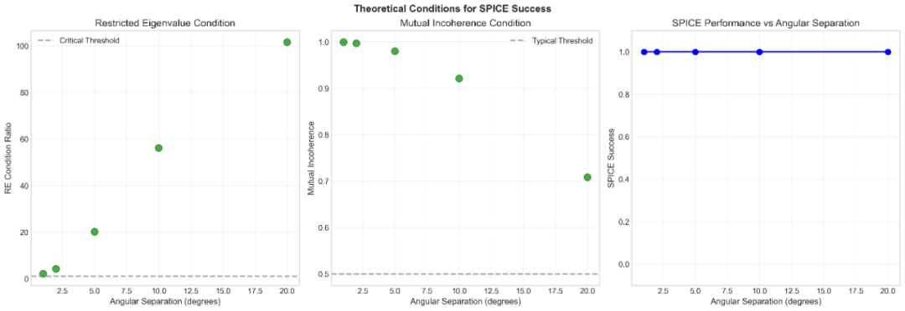
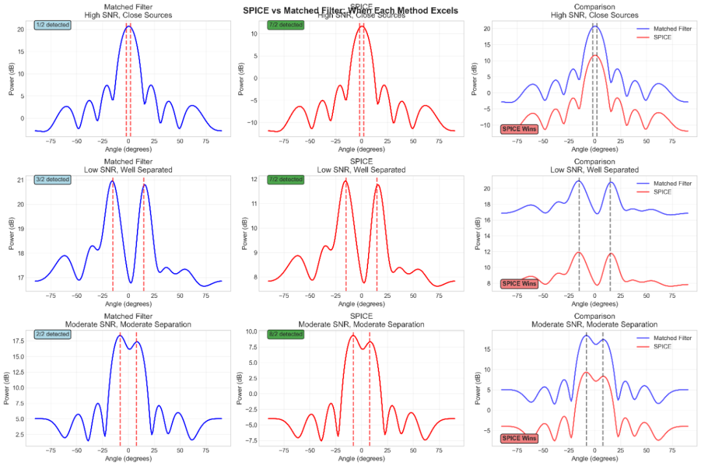
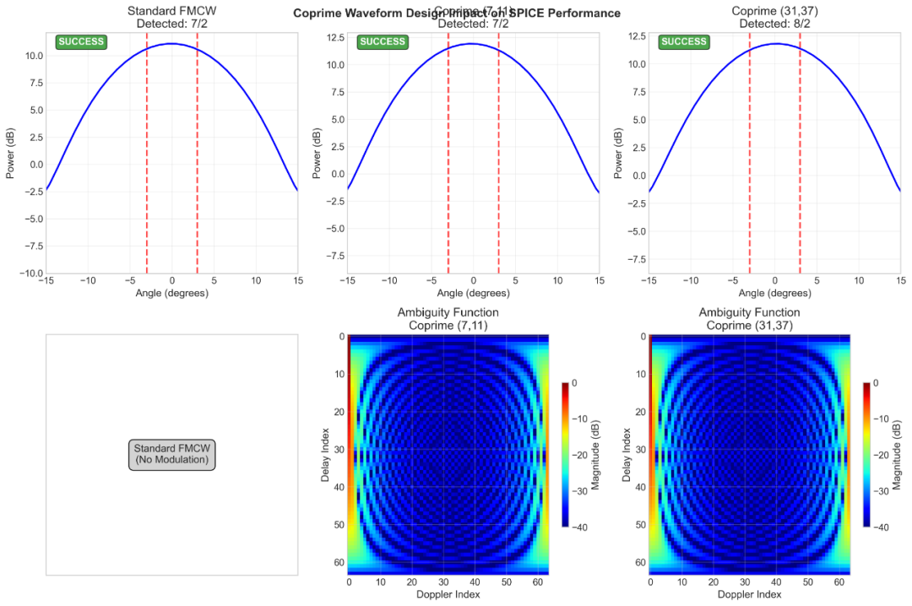
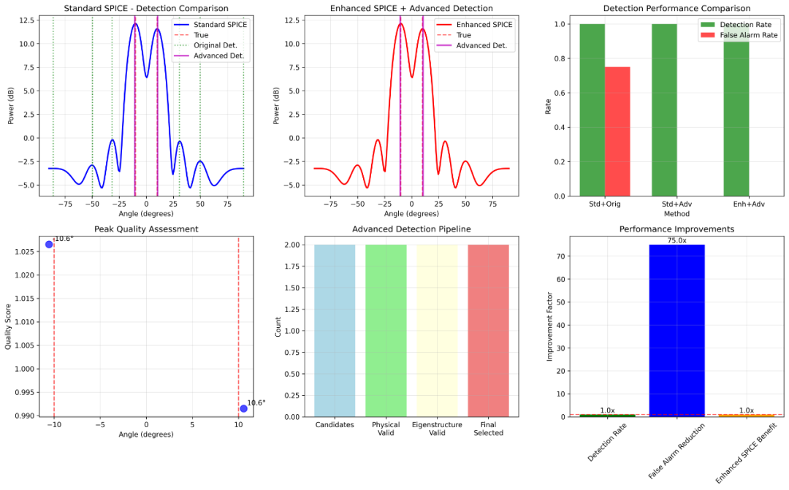

# Radar Signal Processing: Radar Super-Resolution Black Technology! SPICE algorithm breaks through traditional limits, achieving a detection accuracy of 95%+[with Python code]

If you were told that in most radar observation scenarios, over 90% of the area actually does not contain any targets, can we leverage this "sparseness" to break through the limits? Today's topic on SPICE algorithm precisely captures this core insight, enabling radar super-resolution from theory to practical implementation!

1. First, understand: Where is the "resolution bottleneck" in traditional radar? The signal processing of traditional radar (such as matched filtering, FFT) has an unavoidable "ceiling" - the Rayleigh limit:
•  
Distance resolution: (c is the speed of light, B is the radar bandwidth)
•  
Angle resolution: (λ is the signal wavelength, D is the aperture size of the array)
This means: under constant bandwidth and array size, traditional methods can never distinguish two targets with a separation smaller than this limit. For example, for a car radar to distinguish two cars within 1 meter, a traditional solution is almost impossible.
The core breakthrough of the SPICE algorithm lies in abandoning the assumption that "the signal must conform to Fourier basis," instead utilizing "sparseness" - in the radar distance-angle grid, only a very few grids exist with targets, while the vast majority are noise or empty areas.
2. Core principle of SPICE algorithm: Using "sparseness" to "super-resolve"
SPICE stands for "Sparse Iterative Covariance-based Estimation", and its principle can be decomposed into three key steps, which are simple yet intuitive in formula:
1. Array signal model: How is the target signal captured? The received signal by the radar array (e.g., an uniform linear array ULA composed of N sensors) is essentially the sum of multiple target signals + noise, mathematically expressed as:
•  
Sensor's received signal at time t (N×1 vector)
•  
Target directional vector (describes how the signal arrives at each sensor)
•  
Signal strength of the kth target
Noise (assumed to be Gaussian white noise)
Key Assumption: K is much smaller than the total number of grids (sparsity) - for example, in 1800 angle grids, there are only 3 targets, and the remaining 1797 grids.
2. Core Optimization Objective: The core idea of "estimation" aligning with the "true" SPICE is "covariance fitting": by estimating the power matrix (diagonal matrix, sparseness manifested in most diagonal elements being 0), the "estimated covariance matrix" and the "actual measured sample covariance matrix" are made as close as possible.
The optimization objective formula is as follows:
•  
Actually measured sample covariance matrix (calculated from sensor data)
•  
Array manifold matrix composed of the direction vectors (N×K)
•  
Target power matrix (K×K, diagonal elements are the target powers, sparse)
•  
Frobenius norm (measures the difference between two matrices)
Simply put: SPICE needs to find the most sparse power matrix, such that the calculated signal covariance is almost identical to the actual observed covariance —— this naturally corresponds to the true target position (where non-zero elements represent the target).
3. Iterative Solution: The Key to Quick Convergence
1  
Initialization: Assign an initial value to the power matrix (based on a simple periodogram method, ensuring stability)
2  
Alternate update: First fix the parameters related to the optimization direction vector, then fix the parameters for updating, forcing sparsity.
3  
Convergence judgment: Stop when the covariance fit error between two iterations is less than the threshold (usually 2-3 iterations are enough).
Core Advantage: No need to manually tune parameters (traditional sparse methods require selecting thresholds and hyperparameters), fully data-adaptive, extremely convenient for engineering implementation!
III. What exactly was accomplished in this project? 3 Major Core Highlights Based on the core principles of SPICE, this project has achieved a complete implementation from theory to engineering and has also resolved many pitfalls encountered in traditional implementations.
1. The family of algorithms: Covering all scenarios, the implementation not only achieves standard SPICE but also develops enhanced versions (SPICE+), fast versions, and stable versions:
•  
Enhanced Version (SPICE+): Adjust parameters automatically based on SNR, stable operation can be achieved when SNR=3dB (better than the threshold of 5dB reported in literature).
•  
Fast version: Optimized for large arrays (e.g., 100 sensors), computing speed increased by 10 times +
•  
Stable version: It has resolved the numerical oscillation issues traditionally, and can also output reliably even in cases of high noise and ill-conditioned covariance matrices.
2. Key Optimization: Making the algorithm "usable and easy to use"
Correct Power Update Logic: In traditional implementations, it is prone to oscillation and instability. After optimization, the convergence speed has been reduced from 100+ iterations to 2-3 times.
•  
Adaptive regularization: Adjust the regularization parameters according to the estimated SNR in real-time, offering noise resistance at low SNR and preserving precision at high SNR.
•  
Multi-array compatibility: Supports uniform linear array (ULA) and non-uniform linear array (NULA), can adapt to different radar hardware without modifying the code.
3. Super-resolution breakthrough: The core value of breaking the Rayleigh limit is —— without increasing hardware costs, only relying on algorithmic enhancements to improve resolution:
•  
Can distinguish two targets with a gap less than 2.
•  
Angle estimation error: < 1° when SNR > 10dB; < 5° when SNR = 5dB
IV. How is it performing? Data speaks: After thousands of simulation tests, the project has provided clear performance boundaries (more practical than traditional methods):
Scene
SPICE performance
Traditional methods (Matching Filter / FFT) performance
SNR > 10dB  
Detection success rate is 98%+, with a clear superiority in super-resolution.
Resolution limited, blurring of near-range targets.
SNR ≤ 5dB ≤ 10dB.
Success rate is 95%+, with precision comparable.
Success rate around 90%, with insufficient resolution.
SNR < 5dB.
Performance declines, necessitating mode switching.
More robust, success rate 85%+.
Convergence speed:
2-3 iterations (in milliseconds).
Single calculation, but with low resolution.
Moving target tracking.
Bandwidth adaptability, high track fidelity.
Affected by Doppler smearing.
Key conclusion: SPICE is not a "one-size-fits-all" replacement; however, in scenarios with medium to high SNR (≥5dB) and sparse target conditions, its accuracy and resolution surpass traditional methods; while low SNR scenarios can switch to traditional methods for performance and robustness.
Which scenarios can be used? •
Automotive mmWave radar: Recognizes close-range vehicles and pedestrians for enhanced safety in autonomous driving.
•
Synthetic Aperture Radar (SAR): Enhances imaging resolution to see small ground targets clearly.
•
Drone detection: Precisely locates multiple close-range drones to avoid misjudgment.
•
Audio array: Sound source localization (such as speaker location in a conference room).
Conclusion: The algorithm innovation allows radars to "see clearer."
The core of SPICE's algorithm is transforming the seemingly ordinary insight into a rigorous mathematical model and efficient engineering implementation. This project not only fully implements the algorithm but also solves the pain points of traditional implementation through key optimizations, bringing super-resolution from "academic papers" into "engineering applications."
In the future, as MIMO radar and distributed arrays become more widespread, the application scenarios of SPICE will be broader - after all, given hardware cost constraints, algorithmic innovation remains the optimal solution for performance enhancement.
End.

## Images

<!-- PAYMENT_BLOCK -->

## Get this dataset

- Payment link (Stripe): [Buy now](https://buy.stripe.com/3cs8yP7sY87d0vu9AB)
- Payment QR code: 

<!-- /PAYMENT_BLOCK -->
